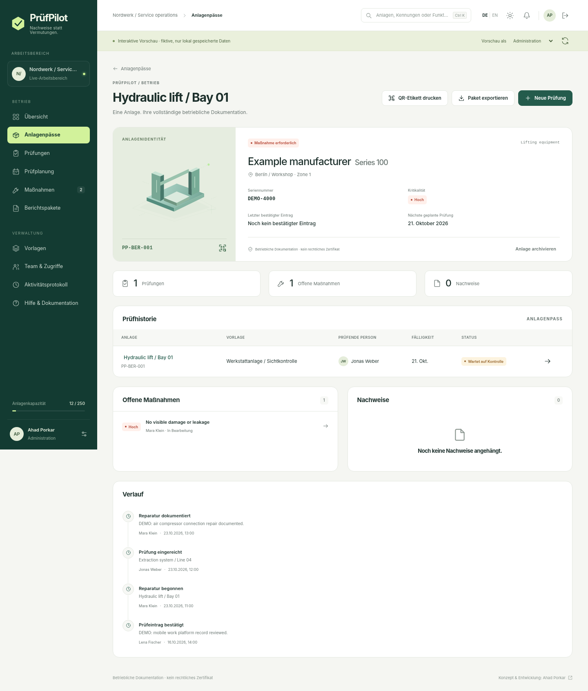

# PrüfPilot
### Jede Anlage. Jede Prüfung. Ein verifizierter Abschluss.

**Prüfungen, Instandhaltungsnachweise und Maßnahmen für Werkstatt- und Facility-Teams.**

[English](README.md) · [Benutzerhandbuch](docs/de/USER_GUIDE.md) · [Betrieb](docs/de/DEPLOYMENT.md) · [Architektur](docs/de/ARCHITECTURE.md)



**Version 1.0.0-rc.1: Release Candidate, keine unabhängig geprüfte Produktionsfreigabe.** 145 Frontend-Tests und 61 Prüfungen der tatsächlichen Java-Domänenregeln wurden ausgeführt. Die vollständige Spring-/PostgreSQL-, Docker- und Browser-E2E-Prüfung ist vorbereitet, konnte in der Erstellungsumgebung aber nicht ausgeführt werden. [Nachweise und Grenzen](docs/quality/VERIFICATION.md).

## Zweck

Welche Prüfungen sind fällig? Was wurde geprüft? Was ist aufgefallen? Wer hat die Reparatur unabhängig bestätigt? Der Anlagenpass vereint Identität, Prüfhistorie, Nachweise, offene Maßnahmen und Ereignisse.

```text
Pruefung faellig -> Anlage identifizieren -> Pruefen -> Mangel zuweisen -> Reparatur dokumentieren -> Abschluss verifizieren
```

Enthalten sind Standorte und Anlagen, echte QR-Kennzeichnung, zweisprachige Vorlagen, explizit konfigurierte Intervalle, mobile Formulare, serverseitige Entwürfe, Befunde, zugewiesene Reparaturen, Nachweise, Vier-Augen-Prüfung, EN/DE-Berichtspakete, fünf Rollen, Audit-Ereignisse sowie helle und dunkle Darstellung. **Die Standardsprache ist Englisch**; die Auswahl DE wird lokal gespeichert.

## Sofortige Oberflächenvorschau

```bash
node frontend/scripts/serve.mjs
```

**http://127.0.0.1:4173/?demo=1#/overview** öffnen. Die ausdrücklich gekennzeichnete Vorschau enthält ausschließlich fiktive Daten. Sie speichert nichts dauerhaft und ersetzt keine Anmeldung oder Datenbank.

## Vollständige Anwendung starten

Docker mit Compose und Python 3 installieren. Im Projektordner:

```bash
python scripts/setup.py --demo --email owner@example.test
docker compose up --build -d
```

**http://localhost:8080** öffnen. Zugangsdaten stehen in der neu erzeugten `.env`. Die Datei ist geheim und darf nicht veröffentlicht werden. Der erste Build benötigt Internetzugriff. Ohne `--demo` entsteht ein leerer Arbeitsbereich. Initialisierung erfolgt nur bei leerer Datenbank. `docker compose down -v` löscht alle Daten des Volumes.

## Technologie und Qualität

Konfiguriert sind Java 27, Spring Boot 4.1.2, PostgreSQL 18.6, Maven 3.10.0, Node.js 26.12.1, TypeScript 7.0.2 und Playwright 1.64.1. Versionsstand: 23.10.2026, mit [Primärquellen](docs/SOURCES.md). Die Oberfläche nutzt native ES-Module, ein Custom Element und CSS ohne externe Laufzeitbibliothek.

Die vorhandene Umgebung nutzte für die tatsächliche Frontend-Kompilierung TypeScript 5.8.3, nicht den vorgesehenen Compiler 7.0.2. 66 statische Layoutprüfungen bestanden, und der generierte QR-Code wurde dekodiert. Die Screenshots sind echte Renderings der Anwendung mit fiktiven Daten, kein Nachweis einer produktiven Installation.

GitHub Actions prüft Frontend, Java-Unit-Tests, echte PostgreSQL-/HTTP-Integration und Container. Der erste erfolgreiche Netzbuild muss eine geprüfte npm-Lockdatei erzeugen; danach auf `npm ci` umstellen. Ein erfolgreicher CI-Lauf wird hier nicht behauptet.

## Fachliche und kommerzielle Grenzen

PrüfPilot koordiniert und dokumentiert. Die Anwendung bestimmt keine gesetzlichen Prüffristen und zertifiziert keine Arbeitsmittel. Fachlich geeignete Vorlagen, befähigte Personen, Signaturanforderungen und Aufbewahrung sind vom Betreiber zu prüfen. SHA-256-Prüfsummen sind keine digitale Signatur. Eine Dateityperkennung ist kein Virenscanner.

Ein Deployment entspricht einem Arbeitsbereich mit bis zu 250 aktiven Anlagen. Kein Self-Service-SaaS, keine Abrechnung, kein OIDC/MFA, keine Offline-Synchronisation und keine automatisierten Zertifikate. Die Rolle VIEWER sieht den gesamten Arbeitsbereich und ist kein kundenseitig abgeschottetes Portal.

EUR 79–249 pro Standort und Monat ist eine **unvalidierte Preishypothese**. Vor Kundeneinsatz sind die [Freigabekriterien](docs/de/PRODUCT.md) abzuarbeiten. MIT erlaubt kommerzielle Nutzung, schafft aber keine Exklusivität am Quellcode.

Für **Ahad Porkar**: [Website](https://ahadporkar.com/) · [GitHub](https://github.com/AhadPorkar) · [LinkedIn](https://www.linkedin.com/in/seapr/).
