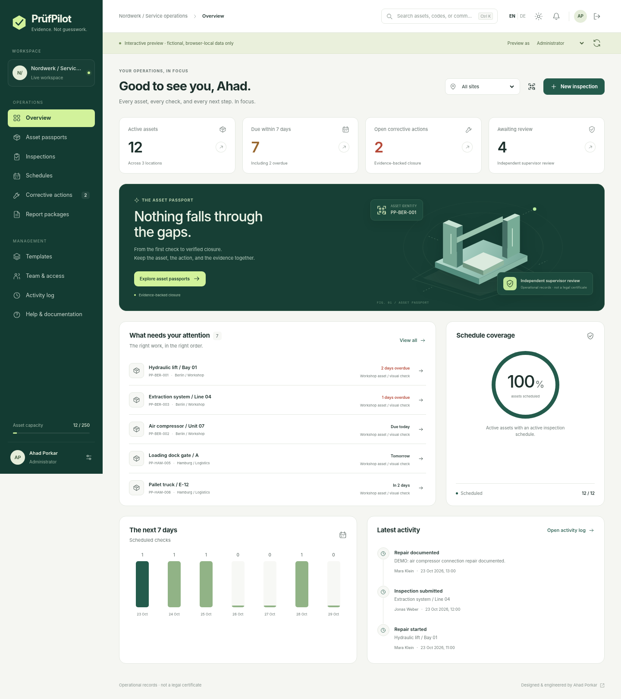

# PrüfPilot
### Every asset. Every check. A verified close.

**Asset inspections, maintenance evidence and corrective actions for workshop and facilities teams.**

[Deutsch](README.de.md) · [User guide](docs/en/USER_GUIDE.md) · [Architecture](docs/architecture/ARCHITECTURE.md) · [API](docs/architecture/API.md) · [Verification](docs/quality/VERIFICATION.md)



**Release: 1.0.0-rc.1 — not an independently audited production release.** The frontend and framework-free Java rules were exercised in the authoring environment. The full Spring/PostgreSQL build, container and browser E2E suites are supplied but were not executable there. See the exact evidence and release gates below. No CI badge is shown until a real run exists.

## The product

PrüfPilot answers four operational questions: **What is due? What was inspected? What failed? Who independently verified the repair?** Its signature interface is an asset passport: identity, inspection history, evidence, open actions and audit events together.

```text
Check due -> Identify asset -> Inspect -> Assign finding -> Document repair -> Verify closure
```

The initial niche is a workshop or facilities operator with identifiable equipment and a bounded asset register. This is not a generic form-builder, automated equipment certificate or predictive-maintenance platform. The operator determines inspection suitability, intervals and competent personnel.

### Implemented

| Area | Delivered behavior |
|---|---|
| Sites and assets | Workspace-scoped register, codes, metadata, search, site/category filters, archive safeguards, asset passports |
| Identification | Real client-generated QR labels, printable identification, manual code lookup, optional supported-browser camera scanning |
| Templates | EN/DE labels, pass/fail/not applicable, numeric ranges, text answers, review/publish, immutable published versions and clone-to-revise |
| Scheduling | Explicit calendar cadence, documented interval basis, responsible person, due queue, pause safeguards |
| Inspections | Mobile-responsive forms, server-backed drafts, original-inspector ownership, atomic submission, server-calculated outcomes |
| Findings and repairs | Failed-check creation, assignment, priority, due date, repair evidence, explicit state machine |
| Review | Independent inspection review and independent repair closure; no self-verification |
| Evidence | PNG/JPEG/PDF allowlist, bounded sizes, atomic PostgreSQL storage, SHA-256 metadata, authenticated attachment downloads |
| Reports | EN/DE ZIP containing printable HTML, JSON, three CSVs, original evidence and a verifiable checksum manifest |
| Security and traceability | Session authentication, CSRF, five roles, per-request account checks, tenant-scoped queries, row locks, optimistic versions, append-only audit trigger |
| Interface | English default, persistent EN/DE preference, light/dark themes, responsive navigation, keyboard command search, reduced-motion support |

## Run the interface immediately

The ZIP includes a compiled frontend. No npm download is needed for the explicit fictional preview.

```bash
node frontend/scripts/serve.mjs
```

Open **http://127.0.0.1:4173/?demo=1#/overview**. The preview banner and role selector are intentional. Data lives in that tab's memory and resets on reload. It does not authenticate users or store customer records. Backend failures never silently activate preview mode.

## Run the full application

Install Docker Engine/Desktop with Compose and Python 3, then run from the repository root:

```bash
python scripts/setup.py --demo --email owner@example.test
docker compose up --build -d
```

Open **http://localhost:8080**. Read `ADMIN_EMAIL` and `ADMIN_PASSWORD` from the newly generated local `.env`; do not post that file anywhere. The first build requires internet access to npm, Maven Central and container registries.

`--demo` seeds fictional backend records on an **empty database only**. For real onboarding, omit `--demo` and follow [deployment](docs/en/DEPLOYMENT.md). Four optional demo users share the generated `DEMO_PASSWORD`: `supervisor@pruefpilot.test`, `inspector@pruefpilot.test`, `technician@pruefpilot.test`, and `viewer@pruefpilot.test`. No fixed production password is shipped.

Changing `.env` after provisioning does **not** rotate database or account passwords. `docker compose down` preserves data; `docker compose down -v` destroys it.

## Technology baseline

Version research date: **23 October 2026**. Stable releases were selected rather than release candidates.

| Component | Configured version |
|---|---|
| Java | 27; runtime image Temurin `27_35-jre-resolute` |
| Spring Boot | 4.1.2; compatible dependency versions managed by its BOM |
| PostgreSQL | 18.6 |
| Maven | 3.10.0 in the Docker build |
| Node.js | 26.12.1 Current, build tooling only |
| TypeScript | 7.0.2 |
| Playwright | 1.64.1 |
| Frontend runtime | Native ES modules, custom element, CSS, SVG and browser APIs; no third-party runtime framework |

[Primary version sources and trade-offs](docs/SOURCES.md). Java 27 and Node Current are the requested current lines, not a claim that non-LTS is preferable for every operator. Maintain their update cadence. Runtime application dependencies follow Spring Boot compatibility management; they are not independently forced to unrelated latest versions.

## Tests and verification

```bash
# Standalone production Java domain rules (JDK 21+ for this subset)
sh scripts/test-domain.sh

# Operator setup and report-integrity tests
python -m unittest discover -s scripts/tests -v

# Frontend compiler and unit/contract tests
cd frontend
npm install
npm run build
npm test
npx playwright install chromium
npm run test:e2e

# Full Java unit + PostgreSQL integration suite, with a dedicated test DB configured
cd ../backend
mvn verify
```

**Executed here:** 145 frontend tests passed; 22 interactive component checks and 17 operator-tool tests passed; 61 assertions against actual Java domain sources passed; strict TypeScript compilation passed using the available 5.8.3 compiler; 66 static-render viewport/dialog overflow checks passed; the generated QR was decoded successfully. Screenshots show actual rendered application views using fictional seed data.

**Not executed here:** Spring Boot/Maven/JUnit suite, PostgreSQL migrations and integration, Docker image/Compose, Playwright live-navigation E2E, TypeScript 7 compiler. Tooling/network restrictions prevented those checks. The included GitHub Actions workflow performs them in a normal networked runner. No coverage percentage, penetration-test result, accessibility certification or successful CI run is invented.

The first networked build must generate and review `frontend/package-lock.json`, commit it, and replace `npm install` with `npm ci`. Exact direct dependency versions are pinned; transitive dependency immutability is not claimed until that gate is completed.

## Engineering worth reviewing

Read `InspectionService` for transactionally calculated failures, advisory idempotency locks and review-controlled schedule advancement. Read `ActionService` and the framework-free domain rules for assigned-person repair and four-eyes closure. The migration demonstrates composite tenant foreign keys and append-only audit enforcement; `ReportService` demonstrates repeatable-read exports, escaping, CSV injection neutralization and a checksum manifest. The UI deliberately keeps the same API contract behind live and explicit preview adapters.

The project uses a modular monolith rather than premature microservices. It does not use framework novelty to hide incomplete business behavior. [Architecture decisions](docs/architecture/ARCHITECTURE.md) explain the boundaries and trade-offs.

## Documentation

| Purpose | English | Deutsch |
|---|---|---|
| End-user operations | [User guide](docs/en/USER_GUIDE.md) | [Benutzerhandbuch](docs/de/USER_GUIDE.md) |
| Deployment and recovery | [Operations guide](docs/en/DEPLOYMENT.md) | [Betriebshandbuch](docs/de/DEPLOYMENT.md) |
| Local development | [Developer guide](docs/en/DEVELOPMENT.md) | [Entwicklerhandbuch](docs/de/DEVELOPMENT.md) |
| Publish to GitHub | [Publishing guide](docs/en/PUBLISH.md) | [Veroeffentlichung](docs/de/PUBLISH.md) |
| Commercial scope | [Product and launch gates](docs/en/PRODUCT.md) | [Produkt und Freigabe](docs/de/PRODUCT.md) |

[Architecture and code map](docs/architecture/ARCHITECTURE.md) · [API contracts](docs/architecture/API.md) · [German architecture overview](docs/de/ARCHITECTURE.md) · [Security](SECURITY.md) · [Offline documentation portal](docs/index.html) · [Fictional report examples](docs/examples/README.md)

## Important product limits

A deployment provisions one workspace; there is no public signup, subscription billing, OIDC/MFA, email delivery, offline synchronization, sensor integration, predictive maintenance or automated certification. The initial cap is 250 active assets. Catalog records are created and archived, not generally editable in this release; published templates are revised by cloning. History is retained rather than silently deleted.

A **VIEWER can read the entire workspace**. It is an internal read-only role, not a customer-isolated portal. Send selected report packages to customers instead of granting that role to an unauthorized external party.

Checksums are not digital signatures. Audit rows are not cryptographically tamper-proof against privileged database operators. File signatures are not malware scanning. GDPR readiness depends on the operator's lawful purpose, retention policy, hosting, contracts and operational controls, not a software label.

## Commercial hypothesis

A managed B2B pilot could test **EUR 79–249 per site/month** or an organization plan with explicit asset limits. These are unvalidated hypotheses, not implemented billing or proven willingness to pay. Complete the [release checklist](docs/en/PRODUCT.md#release-gates) before taking production customer data or making compliance promises.

## Author and license

Prepared for **Ahad Porkar**: [Website](https://ahadporkar.com/) · [GitHub](https://github.com/AhadPorkar) · [LinkedIn](https://www.linkedin.com/in/seapr/).

MIT-licensed source. Commercial use is permitted; the license does not create proprietary exclusivity or transfer third-party trademarks. Review the license choice before publishing a closed-source commercial strategy. No external customer, accreditation, employer endorsement or production deployment is claimed.
