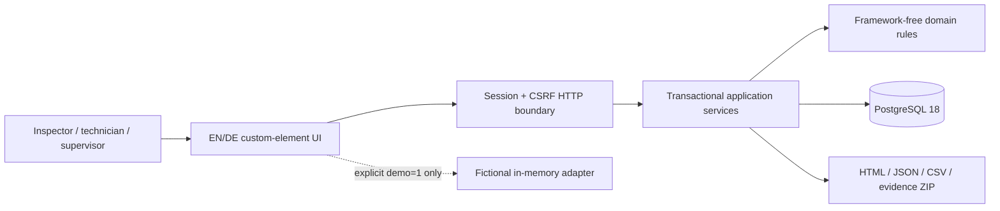
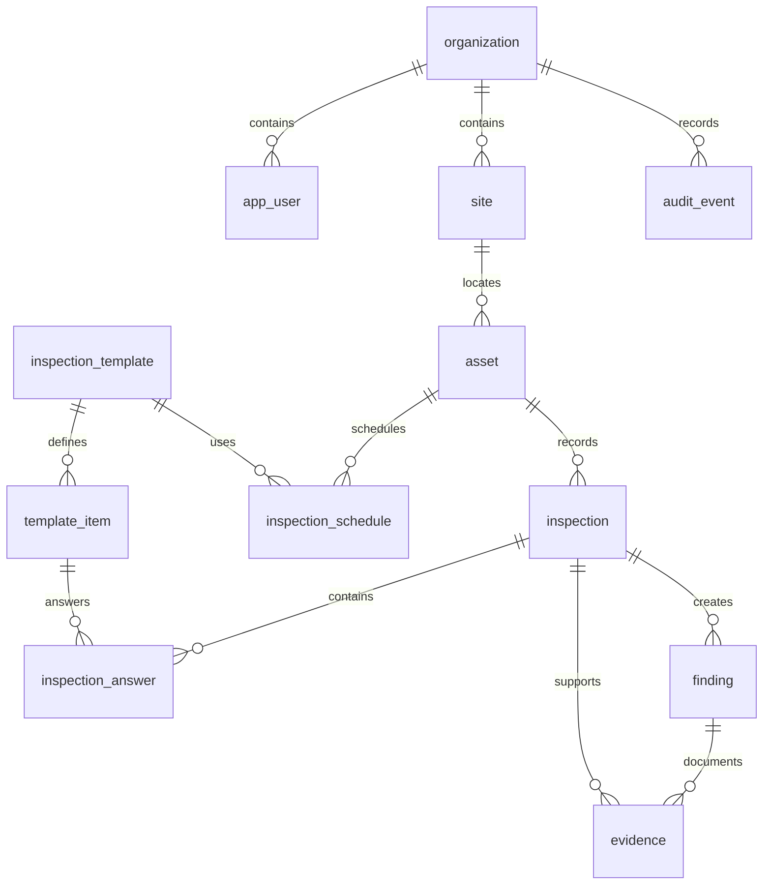
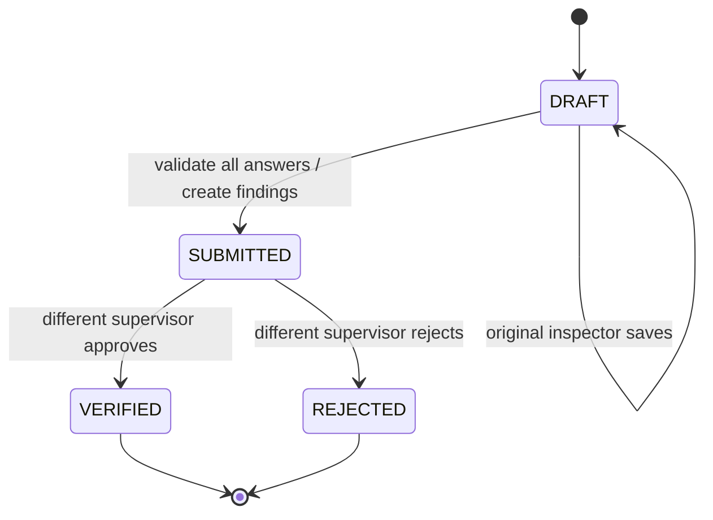
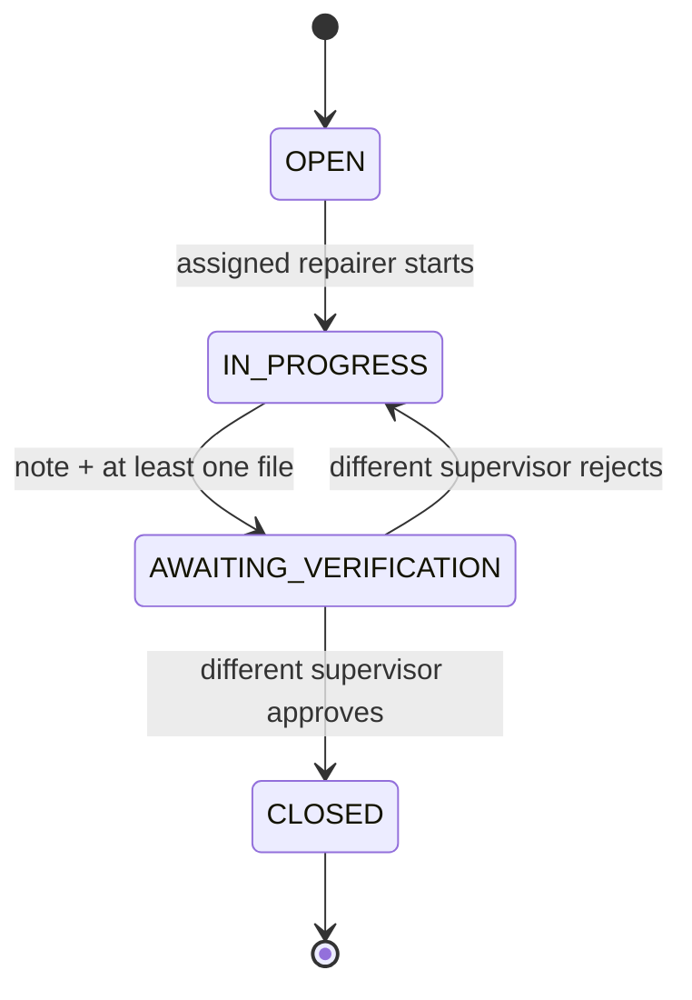

# Architecture and code documentation

## 1. System context

PrüfPilot is a single-deployable modular monolith for a bounded workshop/facility asset register. The browser and API share one origin. A Spring Boot service enforces all authoritative rules and stores records, evidence and audit in PostgreSQL. A separate explicit in-memory preview adapter exists only for demonstration.

The organization identifier and role come from the authenticated `Actor`, never a submitted organization field. This release provisions a single workspace per deployment; organization-aware modeling is defense in depth and an extension point, not a claim that SaaS onboarding/billing is implemented.

## 2. Backend module map

| Package / class | Responsibility and invariants |
|---|---|
| `PruefPilotApplication` | Spring entry point and injected UTC `Clock` |
| `api.Commands` | Validated HTTP input records; bounded text, enums, UUIDs, decimal precision and collection sizes |
| `api.ApiController` | Thin route layer; maps HTTP status/media types to service calls; never owns business state transitions |
| `api.WorkspaceService` | Bounded dashboard projection and paged asset passport; organization-local business date, UTC server time |
| `auth.Actor` | Authenticated server principal, role assertion, safe public projection without password hash |
| `auth.UserDirectory` | Normalized-email lookup and BCrypt-authentication principal loading |
| `auth.SecurityConfig` | Session/form-login, CSRF, protected routes, safe auth errors, CSP and permissions policy; per-request disabled/role/password-hash revocation guard |
| `auth.LoginLimiter` | Framework-free, bounded per-process IP/minute rate limiter; edge/global limits required for multiple nodes |
| `auth.AuthController` | CSRF bootstrap and safe current-user endpoint |
| `auth.MemberService` | Admin-managed accounts, self-disable prevention, password byte/length policy and password rotation |
| `catalog.CatalogService` | Sites, bounded active assets, immutable reviewed templates, explicit schedules, archive/pause safeguards |
| `inspection.InspectionService` | Idempotent starts, inspector-owned drafts, atomic submissions, server outcomes/finding creation, independent reviews and cadence advancement |
| `action.ActionService` | Assignment and state transitions; only the assignee repairs; different authorized person verifies |
| `evidence.EvidenceService` | Parent ownership/status checks, content signature allowlist, file/asset quota, atomic bytea metadata/content, authenticated downloads |
| `report.ReportService` | Repeatable-read asset export, two-slot limiter, HTML/CSV sanitization, original files and checksum manifest |
| `audit.AuditService` | Append events in caller transaction and retrieve bounded history |
| `shared.Db` | Prepared SQL adapter, safe one/optional/count/bytes queries, snake_case-to-camelCase and timestamp/UUID serialization |
| `shared.Errors`, `ApiException` | Stable error codes and RFC-style problem responses without SQL or stack details |
| `shared.Bootstrap` | One-time initial workspace/account, optional fictional seed, production startup safety checks |
| `domain.*` | Dependency-free inspection, scheduling, corrective-action, file and export rules; executable without Spring |

Services use Spring transactions on public mutation methods. Domain rules have no Spring imports, making core decisions easy to isolate. JDBC is deliberate: the SQL makes tenant predicates, row locks, uniqueness and export queries visible instead of hiding them behind implicit ORM behavior.

## 3. Data model

Every business relationship uses `(organization_id, id)` composite foreign keys. Globally unique IDs are not an authorization mechanism. All read/write service queries include the actor's organization predicate. Cross-workspace reads return not-found rather than confirming another workspace's record. The application does not enable PostgreSQL row-level security; do not describe it as RLS-protected.

Important database constraints: unique organization/asset code and site code; one active asset/template schedule; one draft/submitted inspection per schedule; one organization/request-key inspection; one finding per inspection/item; valid state/role enums; numeric range checks; nonempty bounded evidence. Query indexes cover due schedules, asset history and finding queues. See the migration for exact columns/defaults.

The `audit_event` trigger rejects updates/deletes. The normal DML role has no ALTER/TRUNCATE privilege under Compose initialization. A privileged database owner can still replace data or disable controls; this is not cryptographic immutability. Normal APIs do not mutate submitted answers or reviewed template items. Retention/pseudonymization must be designed as an explicit operator process.

## 4. State machines

Rejected records remain. A new inspection gets a new identity rather than reopening an old submission. Approval reviews the record; it does not automatically close findings or assert equipment safety.

The server does not accept a client-supplied outcome/status as authority. Numeric/check outcomes are recalculated. A repairer must equal `assignee_id`; role alone is insufficient. A verifier must not equal `completed_by`, including for administrators.

## 5. Transaction and concurrency design

**Inspection start:** an advisory transaction lock keyed by organization and client request UUID serializes same-key retries. Existing matching key/input returns the existing record; reuse with different payload/actor conflicts. The database unique key backs this guarantee. An asset row lock prevents racing archive/start. The schedule row and partial unique index prevent concurrent running inspections.

**Submission:** lock the inspection, check owner/state/version, validate template membership and every answer, upsert answer rows, insert failed-check findings, update status/timestamps and append audit in one transaction. Any exception rolls back all of these writes. Draft saves also increment the optimistic version.

**Review:** lock inspection and enforce independent reviewer; check supplied version; persist review; lock schedule and compare its original planned due date; calculate next due from the original calendar anchor using the performed date in the organization zone. All steps commit together. A rejected record leaves due unchanged.

**Repair:** lock finding, compare optimistic version, enforce assignment/state and evidence count, then transition and append audit. Evidence upload locks its parent before adding bytes, so completion cannot race a late file into an already submitted repair. Asset-level quota is serialized by an asset lock.

**Capacity:** asset creation locks the organization row before counting the 250-active-asset cap. **Export:** repeatable-read provides a consistent database snapshot; two concurrent in-process slots limit memory pressure. Multi-node operation requires additional shared limits.

Deadlocks are still possible across evolving workflows and should be included in future load tests. A failed transaction must not be interpreted as completed work. No general mutation retry layer hides conflicts from operators.

## 6. Time semantics

Instant events are stored as PostgreSQL `timestamptz` and serialized as ISO UTC strings. Schedules are `date`, not midnight instants. The workspace time zone determines `today` and the performed calendar date used for cadence. Explicit `Clock` injection permits deterministic rule tests. Submission timestamps are system records, not independent evidence of a physical inspection time.

For anchor `a`, performed date `p`, interval `d`, the next date is `a + max(1, floor((p-a)/d)+1)*d`. This keeps the original cadence, advances at least one period and skips missed periods without generating fictional inspections. The software does not determine whether that cadence is legally appropriate.

## 7. Frontend code map

| File | Responsibility |
|---|---|
| `types.ts` | API/domain interfaces and adapter contract |
| `domain.ts` | Client validation, dates, status, escaping, hash/file helpers; advisory only, server is authoritative |
| `i18n.ts` | Complete EN/DE UI dictionaries and localized formatting; English default |
| `api.ts` | Same-origin session HTTP, in-memory CSRF token, error translation, multipart and downloads |
| `demo.ts` | Explicit fictional adapter with state/role checks; never authentication and never fallback |
| `seed.ts` | Fictional data and predictable IDs for tests/screenshots |
| `views.ts` | Escaped page rendering: overview, asset register/passport, inspections, schedules, board, reports, templates, team, audit, help/login |
| `dialogs.ts` | Forms and modal content; mirrored validation hints; template item editor |
| `app.ts` | Custom element, hash routing, event delegation, modal lifecycle, busy/error state, API commands, QR lookup/camera, downloads and preference handling |
| `ui.ts`, `icons.ts` | Escaped reusable UI fragments and original SVG icon/asset art |
| `qr.ts` | Auditable QR Model 2 v5-L byte-mode encoder; Reed-Solomon correction and mask selection; 106 UTF-8-byte capacity |
| `zip.ts` | Small standards-based stored ZIP writer used by explicit preview; server uses Java ZIP |
| `public/styles.css` | Tokenized light/dark visual system, responsive layouts, focus/reduced-motion/print rules |
| `scripts/build.mjs` | Copy public assets beside emitted modules |
| `scripts/serve.mjs` | Local static server and same-origin HTTP backend development proxy, not public production server |

`PruefPilot` renders standard DOM, not a shadow root, allowing simple CSS, native dialogs and accessible form semantics. All record strings are escaped before HTML insertion. Generated action values are controlled identifiers. No customer data is sent to a QR service, CDN, font provider, analytics endpoint or AI model. No service worker/offline cache is installed.

The client keeps current workspace state in memory and refreshes after mutations. It is not an event-sourced client or offline-first system. Optimistic versions expose stale edits instead of silently merging them. Form fields are preserved during an evidence upload refresh, avoiding accidental loss of unsaved notes.

## 8. Evidence and export format

Files are bytea rows with MIME, sanitized filename, size, SHA-256, parent identities and uploader. Signature checks accept PNG/JPEG/PDF prefixes; they do not fully parse files or scan malware. Limits are 10 MiB/file and 50 MiB/asset. Attachment download and no-sniff prevent casual inline interpretation but do not make malicious documents safe to open.

Report schema version 1 includes asset, organization, inspections, answers, findings, evidence metadata, involved people, schedules and referenced templates. The package contains a readable HTML summary, JSON, three CSVs and originals. HTML is escaped. CSV cells with formula-leading values are prefixed to prevent spreadsheet execution. The manifest hashes every other file and excludes itself. It is deliberately described as a checksum manifest, not a signature or certificate.

Only involved people's names/roles are included in the report's person list, not workspace email addresses. Actor names in records still constitute information that may require privacy controls. Exports themselves are audited. Customer-scoped access tokens and a public report portal are not implemented.

## 9. Decisions and trade-offs

**ADR-001: Modular monolith.** One coherent transactional workflow and small product scope do not justify distributed consistency or service-operation overhead.

**ADR-002: JDBC over ORM.** Explicit tenant predicates, PostgreSQL locks and export queries are central. The cost is manual mapping and SQL tests; integration tests must run against real PostgreSQL, not an H2 substitute.

**ADR-003: Cookie session over browser JWT storage.** Same-origin deployment simplifies CSRF/session policy and avoids bearer tokens in localStorage. The cost is single-node session scope until a shared session store is added.

**ADR-004: Native TypeScript UI.** A small standard-API runtime keeps network dependencies, bundle size and maintenance surface low while leaving the visual design bespoke. This is a deliberate alternative to React, not a claim that framework-free is universally superior.

**ADR-005: Atomic bounded evidence in PostgreSQL.** Keeping bytes with records avoids object-store/DB consistency gaps for a 250-asset v1. The cost is database growth, backup size and export memory. Move to scanned object storage with durable upload/outbox semantics when scale justifies it.

**ADR-006: Immutable reviewed/submitted records.** Corrections use new records/versions so historical observations are not silently rewritten. Administrative corrections and retention require explicit governed future workflows.

**ADR-007: Explicit preview adapter.** A recruiter can explore the entire UI without credentials or infrastructure. The visible label and no-fallback rule prevent preview from masquerading as live data.

**ADR-008: Current supported versions with honest verification.** The requested current GA stack is configured, but only available local tools were executed. Networked CI is a release gate, not an assumed result.

## 10. Extension rules

Add a command DTO and server authorization before exposing a new UI action. Include organization predicates and composite foreign keys. Put decision rules in the domain layer, transaction orchestration in services, and HTTP handling in controllers. Add unit and PostgreSQL tests, EN/DE labels, preview parity where meaningful, API docs and a migration. Do not update an applied migration or quietly broaden Viewer access.

Priority extensions after validation: governed metadata correction, OIDC/MFA, account recovery, scanned object storage, retention workflows, scalable historical queries, stronger signed evidence packages where actually required, and optional offline synchronization with explicit conflict rules. Predictive maintenance, mandatory sensors and automatic certification remain outside v1.
